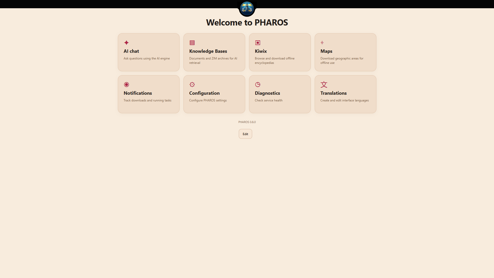
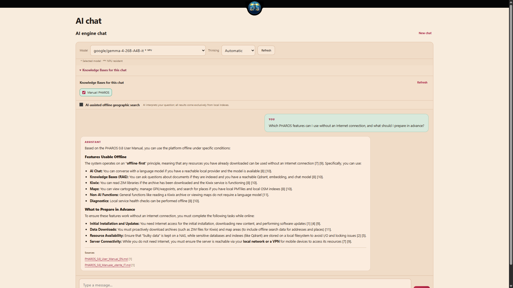
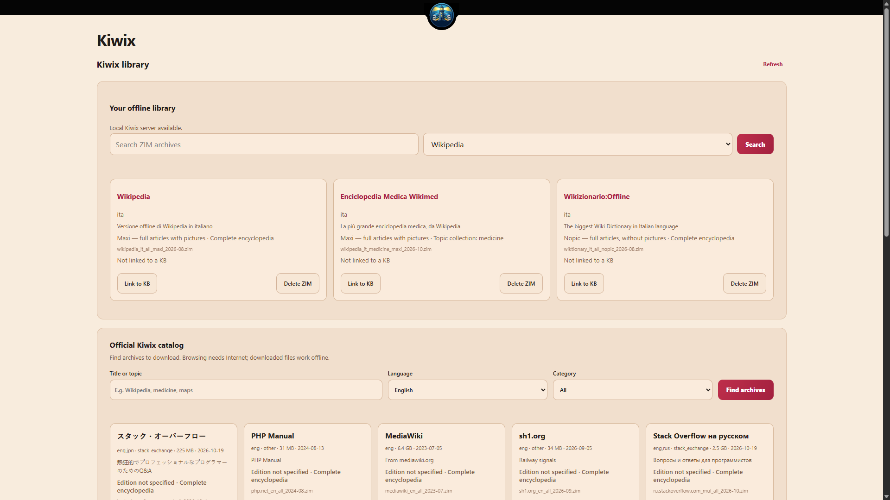
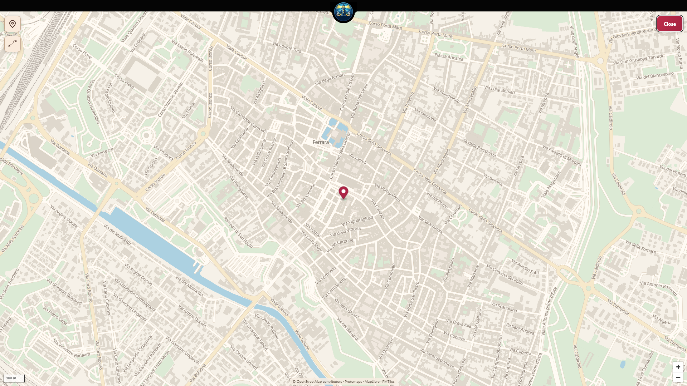

<p align="center"></p>

<h1 align="center">PHAROS</h1>
<p align="center"><strong>La tua conoscenza. La tua infrastruttura. La tua indipendenza.</strong></p>
<p align="center">Piattaforma autonoma di conoscenza e servizi offline-first</p>
<p align="center"><a href="README.md">English</a> · <a href="docs/USER_MANUAL_IT.md">Manuale utente</a> · <a href="LICENSE">Apache 2.0</a></p>

> **0.8.0:** Ubuntu x86-64 è la piattaforma collaudata; Windows x64 è sperimentale. Solo reti LAN/VPN fidate.

## Cos'è PHAROS?

PHAROS riunisce chat IA, risposte basate sui documenti, enciclopedie offline e mappe interattive in un'unica applicazione web sulla propria infrastruttura. Scarica in anticipo le risorse necessarie e consultale tramite browser sulla rete locale, anche quando Internet non è disponibile.

Offline-first non significa che ogni funzione sia automaticamente offline: installazione iniziale, download e aggiornamenti richiedono connettività. L'IA richiede un provider raggiungibile; scegli un provider locale per l'uso offline.

## Screenshot

Una panoramica dell'interfaccia reale di PHAROS 0.8.0. Clicca sulle immagini per visualizzarle alla risoluzione originale.

<table>
  <tr>
    <td width="50%" align="center"><a href="docs/screenshots/home.png"></a><br><strong>Home personalizzabile</strong></td>
    <td width="50%" align="center"><a href="docs/screenshots/rag-chat.png"></a><br><strong>Risposte IA con citazioni delle fonti</strong></td>
  </tr>
  <tr>
    <td width="50%" align="center"><a href="docs/screenshots/kiwix-library.png"></a><br><strong>Biblioteca Kiwix offline</strong></td>
    <td width="50%" align="center"><a href="docs/screenshots/geographic-result.png"></a><br><strong>Mappa offline e ricerca geografica</strong></td>
  </tr>
</table>

[Visualizza tutti i 10 screenshot](docs/screenshots/README.md) (interfaccia in inglese, titoli bilingue).

Dati cartografici © [OpenStreetMap contributors](https://www.openstreetmap.org/copyright), ODbL 1.0. Cartografia: [Protomaps](https://protomaps.com/).

## Funzionalità

| Funzione | Cosa permette di fare |
|---|---|
| Chat IA | Collegare Tiiny Direct, Tiiny Gateway o provider OpenAI-compatible. Selezionare modelli e controlli Thinking supportati. |
| Knowledge Base | Importare PDF testuali, TXT e Markdown; porre domande con citazioni delle fonti tramite RAG. |
| Kiwix | Scaricare archivi ZIM, consultare pubblicazioni offline e collegarle alle Knowledge Base. |
| Mappe offline | Scaricare mappe vettoriali regionali, esplorarle e ingrandirle senza server cartografici esterni. |
| Ricerca geografica | Indicizzare estratti OpenStreetMap; trovare località, strade, indirizzi e POI, anche tramite IA con modelli compatibili. |
| GPX e waypoint | Importare e visualizzare tracce, salvare waypoint personali ed esportarli in GPX. |
| Amministrazione | Configurare servizi, seguire attività in background, verificare aggiornamenti, personalizzare la Home e gestire le traduzioni. |

Nessun Docker obbligatorio. Nessun servizio cloud obbligatorio. Nessun login integrato: utilizzare esclusivamente su LAN fidata o VPN, senza esposizione diretta a Internet.

## Per iniziare

La distribuzione pubblica 0.8 non richiede account GitHub né clone manuale. Verificare il sorgente degli script ufficiali prima di eseguirli.

### Ubuntu x86-64

Ubuntu x86-64, Bash, curl, Python 3.11+, Git, venv e sessione systemd utente. Il setup può proporre i pacchetti Git/Python mancanti tramite sudo. Installare curl dai repository Ubuntu se assente; non eseguire il setup come root.

```bash
setup=$(mktemp) && curl -fsSL https://raw.githubusercontent.com/mascalx/pharos/main/install-pharos.sh -o "$setup" && bash "$setup" --language it
```

Per un NAS dedicato già montato:

```bash
setup=$(mktemp) && curl -fsSL https://raw.githubusercontent.com/mascalx/pharos/main/install-pharos.sh -o "$setup" && bash "$setup" --language it --data-dir /mnt/pharos-data --require-mount
```

### Windows x64 (sperimentale)

Windows x64, PowerShell 5.1+, Git for Windows e Python 3.11+ x64 con launcher py. Il setup propone i prerequisiti mancanti tramite winget; se winget non è disponibile, usare gli installer ufficiali Git/Python. Non sostituisce Python compatibile. Rispettare la policy PowerShell.

```powershell
$setup = Join-Path $env:TEMP ('pharos-' + [guid]::NewGuid().ToString('N') + '.ps1'); Invoke-WebRequest -UseBasicParsing -Uri 'https://raw.githubusercontent.com/mascalx/pharos/main/install-pharos.ps1' -OutFile $setup -ErrorAction Stop; & $setup
```

Avviare PHAROS dal menu Start o dal desktop, lasciare aperto PowerShell e aprire http://127.0.0.1:8080/. Arrestare con Ctrl+C. Servono Internet per il setup, disco scrivibile, spazio adeguato e browser moderno con WebGL per le mappe. Per l'IA offline serve un provider locale compatibile. Database e indici su disco locale; archivi su NAS verificato. Docker e Node.js non necessari. macOS e ARM non qualificati.

## Documentazione

- [Manuale utente italiano](docs/USER_MANUAL_IT.md)
- [English user manual](docs/USER_MANUAL_EN.md)
- [Architettura](docs/ARCHITECTURE.md)
- [Backup e ripristino](docs/BACKUP_RESTORE_060.md)
- [Sicurezza](docs/SECURITY.md)

I manuali Markdown possono essere importati direttamente in una Knowledge Base PHAROS.

## Limitazioni attuali

Non sono disponibili routing stradale, traffico in tempo reale, OCR o garanzia di copertura geografica completa. Le risposte IA e l'interpretazione geografica dipendono dal modello e dalle fonti locali disponibili. Verificare i risultati importanti consultando le fonti. Windows resta sperimentale.

## Contributi e licenza

Le segnalazioni e i contributi devono includere passaggi riproducibili e versione di PHAROS, senza credenziali, documenti privati o dettagli dell'infrastruttura. Vedere [Contributi](CONTRIBUTING.md) e [Sicurezza](SECURITY.md).

Il codice originale PHAROS è distribuito con [Apache License 2.0](LICENSE). Componenti e dati esterni mantengono le rispettive licenze: [avvisi di terze parti](THIRD_PARTY_NOTICES.md). Dati cartografici © OpenStreetMap contributors, ODbL 1.0.

## Disinstallazione

Arrestare PHAROS su Windows. La configurazione e i dati vengono conservati.

Ubuntu:

```bash
setup=$(mktemp) && curl -fsSL https://raw.githubusercontent.com/mascalx/pharos/main/uninstall-pharos.sh -o "$setup" && bash "$setup"
```

Windows:

```powershell
$setup = Join-Path $env:TEMP ('pharos-' + [guid]::NewGuid().ToString('N') + '.ps1'); Invoke-WebRequest -UseBasicParsing -Uri 'https://raw.githubusercontent.com/mascalx/pharos/main/uninstall-pharos.ps1' -OutFile $setup -ErrorAction Stop; & $setup
```

Digitare `REMOVE PHAROS`. Vedere [rimozione completa](docs/UNINSTALL.md).
