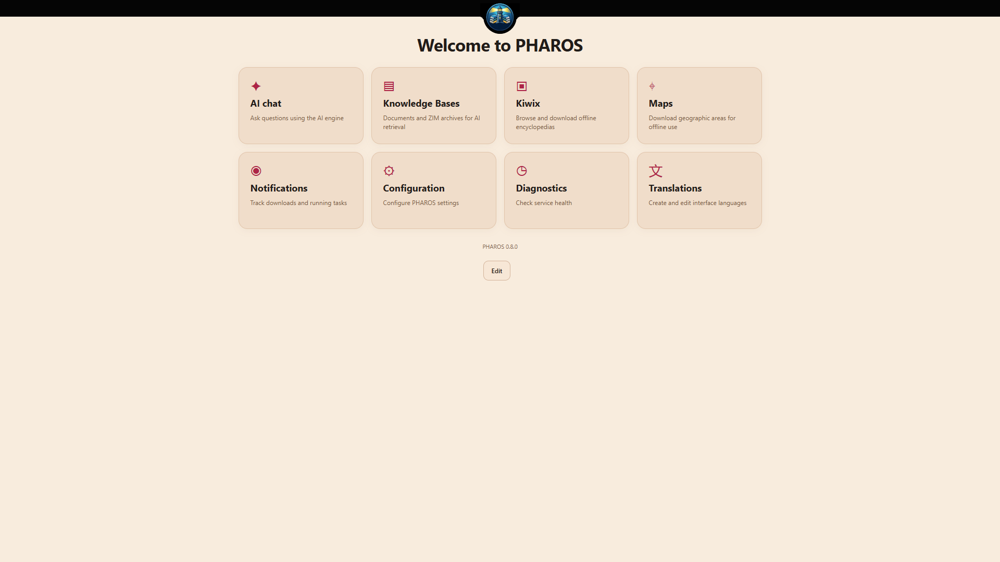
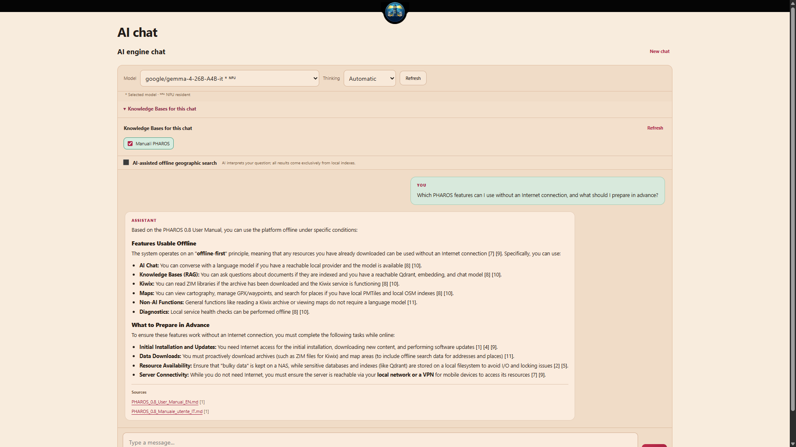
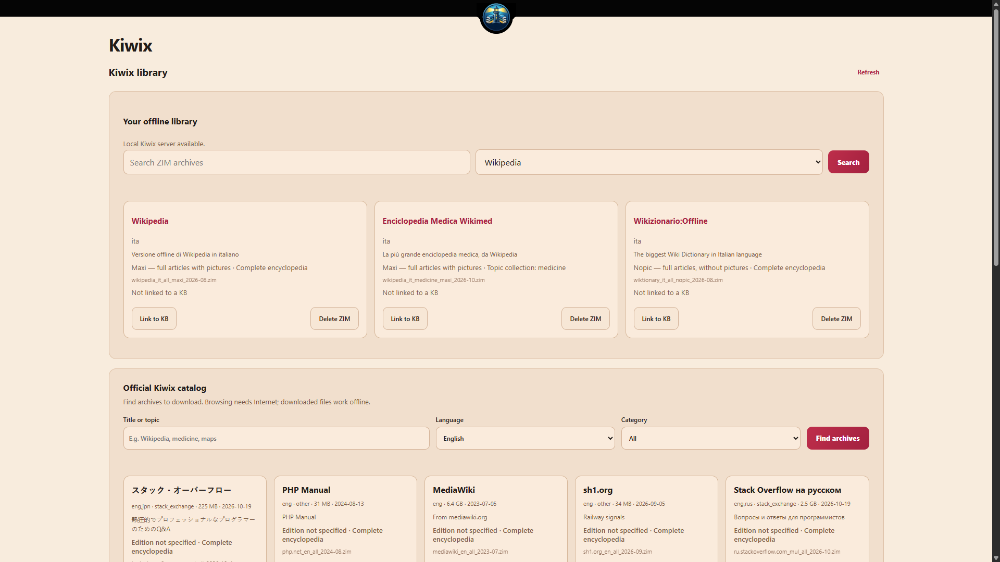
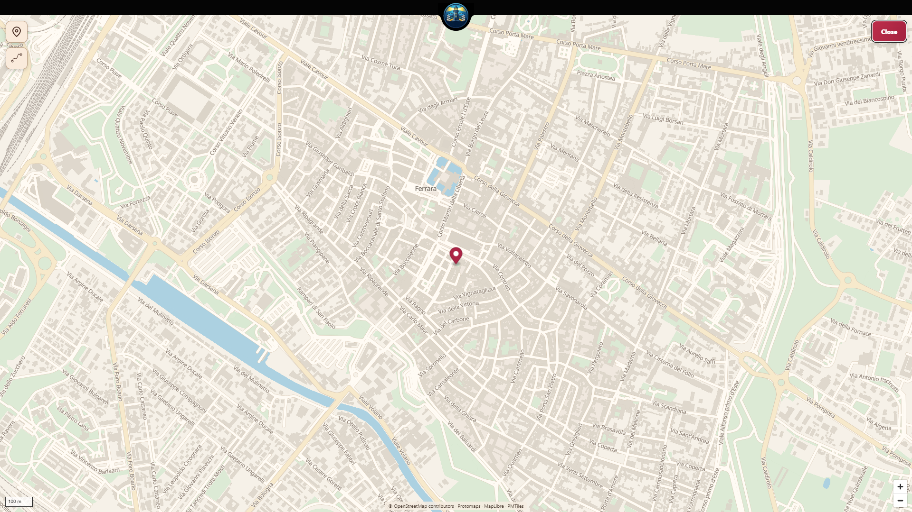

<p align="center"></p>

<h1 align="center">PHAROS</h1>
<p align="center"><strong>Your knowledge. Your infrastructure. Your independence.</strong></p>
<p align="center">Self-hosted, offline-first knowledge and services platform</p>
<p align="center"><a href="README.it.md">Italiano</a> · <a href="docs/USER_MANUAL_EN.md">User manual</a> · <a href="LICENSE">Apache 2.0</a></p>

> **0.8.0:** Ubuntu x86-64 is the qualified platform; Windows x64 is experimental. Trusted LAN/VPN deployments only.

## What is PHAROS?

PHAROS brings AI chat, document-based answers, offline encyclopedias and interactive maps together in a single web application running on your own infrastructure. Download the resources you need in advance and access them through a browser on your local network, even when Internet access is unavailable.

Offline-first does not mean every feature is automatically offline: initial setup, content downloads and updates require connectivity. AI requires a reachable provider; choose a local provider for offline AI.

## Screenshots

A preview of the real PHAROS 0.8.0 interface. Select an image to view it at its original resolution.

<table>
  <tr>
    <td width="50%" align="center"><a href="docs/screenshots/home.png"></a><br><strong>Home dashboard</strong></td>
    <td width="50%" align="center"><a href="docs/screenshots/rag-chat.png"></a><br><strong>AI answers with source citations</strong></td>
  </tr>
  <tr>
    <td width="50%" align="center"><a href="docs/screenshots/kiwix-library.png"></a><br><strong>Offline Kiwix library</strong></td>
    <td width="50%" align="center"><a href="docs/screenshots/geographic-result.png"></a><br><strong>Offline map and geographic search</strong></td>
  </tr>
</table>

[View all 10 screenshots](docs/screenshots/README.md).

Map data © [OpenStreetMap contributors](https://www.openstreetmap.org/copyright), ODbL 1.0. Cartography: [Protomaps](https://protomaps.com/).

## Features

| Feature | What you can do |
|---|---|
| AI chat | Connect to Tiiny Direct, Tiiny Gateway or an OpenAI-compatible provider. Select chat models and supported thinking controls. |
| Knowledge Bases | Import PDF (text-based), TXT and Markdown documents; ask questions with source citations using RAG. |
| Kiwix | Download ZIM archives, browse offline publications and link them to Knowledge Bases. |
| Offline maps | Download regional vector maps, pan and zoom without external tile servers. |
| Geographic search | Index OpenStreetMap extracts; find places, streets, addresses and POIs locally, including AI-assisted queries with compatible models. |
| GPX and waypoints | Import and display tracks, save personal waypoints and export waypoints as GPX. |
| Administration | Configure services, monitor background jobs, check updates, customize the dashboard and manage interface translations. |

No mandatory Docker installation. No mandatory cloud service. No built-in login: deploy only on a trusted LAN or VPN, not directly on the public Internet.

## Getting started

The public 0.8 distribution requires no GitHub account or manual clone. Review the official script source before executing it.

### Ubuntu x86-64

Ubuntu x86-64, Bash, curl, Python 3.11+, Git, venv and a user systemd session. Setup can offer missing Git/Python packages through sudo. Install curl from Ubuntu repositories if absent; do not run setup as root.

```bash
setup=$(mktemp) && curl -fsSL https://raw.githubusercontent.com/mascalx/pharos/main/install-pharos.sh -o "$setup" && bash "$setup"
```

For an already mounted dedicated NAS:

```bash
setup=$(mktemp) && curl -fsSL https://raw.githubusercontent.com/mascalx/pharos/main/install-pharos.sh -o "$setup" && bash "$setup" --data-dir /mnt/pharos-data --require-mount
```

### Windows x64 (experimental)

Windows x64, PowerShell 5.1+, Git for Windows and Python 3.11+ x64 with the py launcher. Setup offers missing prerequisites via winget; if unavailable, use the official Git/Python installers. Compatible Python is retained. Respect PowerShell policy.

```powershell
$setup = Join-Path $env:TEMP ('pharos-' + [guid]::NewGuid().ToString('N') + '.ps1'); Invoke-WebRequest -UseBasicParsing -Uri 'https://raw.githubusercontent.com/mascalx/pharos/main/install-pharos.ps1' -OutFile $setup -ErrorAction Stop; & $setup
```

Start PHAROS from Start or desktop, keep PowerShell open and visit http://127.0.0.1:8080/. Stop with Ctrl+C. Internet for setup, writable storage, adequate disk space and a modern WebGL browser are required. Offline AI needs a compatible local provider. Keep databases and indexes on local disk; archives can use a verified NAS. Docker and Node.js are not required. macOS and ARM are not qualified.

## Documentation

- [English user manual](docs/USER_MANUAL_EN.md)
- [Manuale utente italiano](docs/USER_MANUAL_IT.md)
- [Architecture](docs/ARCHITECTURE.md)
- [Backup and restore](docs/BACKUP_RESTORE_060.md)
- [Security](docs/SECURITY.md)

The Markdown manuals can also be imported into a PHAROS Knowledge Base.

## Current limitations

No turn-by-turn routing, live traffic, OCR or guarantee of complete geographic coverage. AI answers and geographic interpretation depend on the selected model and available local sources. Check important results against their sources. Windows remains experimental.

## Contributing and license

Bug reports and contributions should include reproducible steps and the PHAROS version, without credentials, private documents or infrastructure details. See [Contributing](CONTRIBUTING.md) and [Security](SECURITY.md).

Original PHAROS code is licensed under [Apache License 2.0](LICENSE). External components and datasets retain their own terms: [third-party notices](THIRD_PARTY_NOTICES.md). Map data © OpenStreetMap contributors, ODbL 1.0.

## Uninstall

Stop PHAROS on Windows. Configuration and data are retained.

Ubuntu:

```bash
setup=$(mktemp) && curl -fsSL https://raw.githubusercontent.com/mascalx/pharos/main/uninstall-pharos.sh -o "$setup" && bash "$setup"
```

Windows:

```powershell
$setup = Join-Path $env:TEMP ('pharos-' + [guid]::NewGuid().ToString('N') + '.ps1'); Invoke-WebRequest -UseBasicParsing -Uri 'https://raw.githubusercontent.com/mascalx/pharos/main/uninstall-pharos.ps1' -OutFile $setup -ErrorAction Stop; & $setup
```

Type `REMOVE PHAROS`. See [complete removal](docs/UNINSTALL.md).
