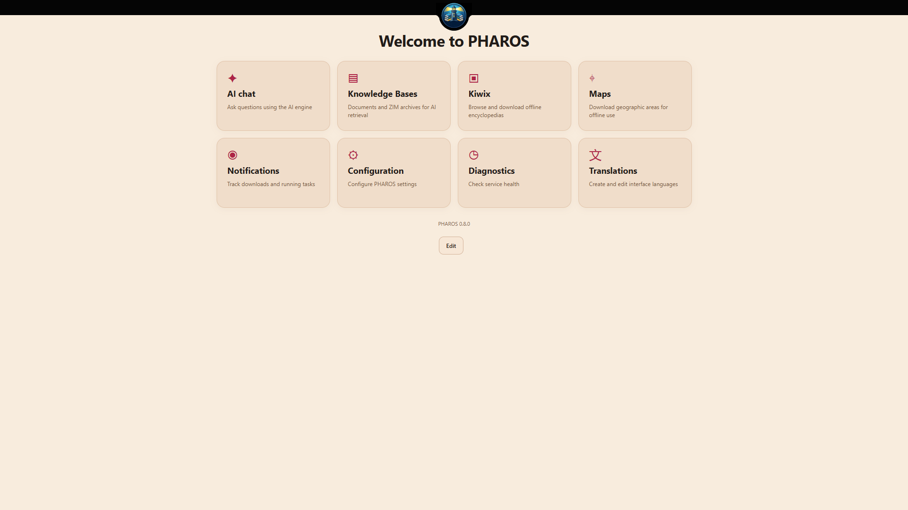
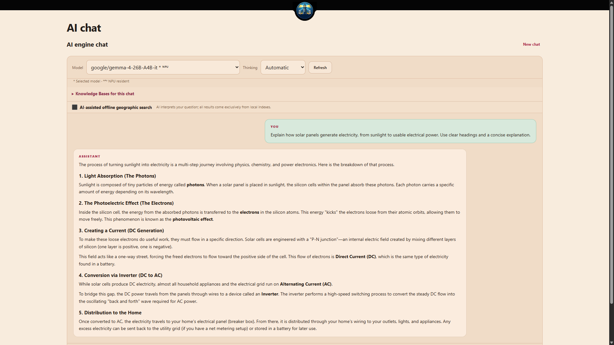
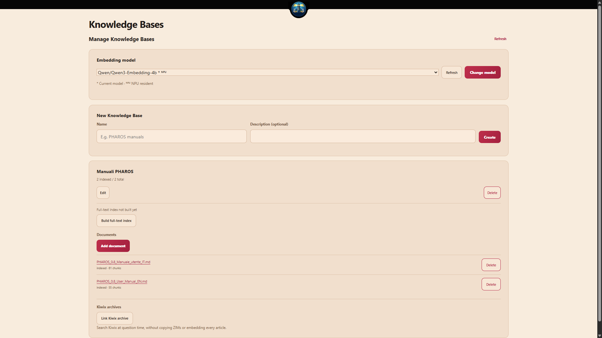
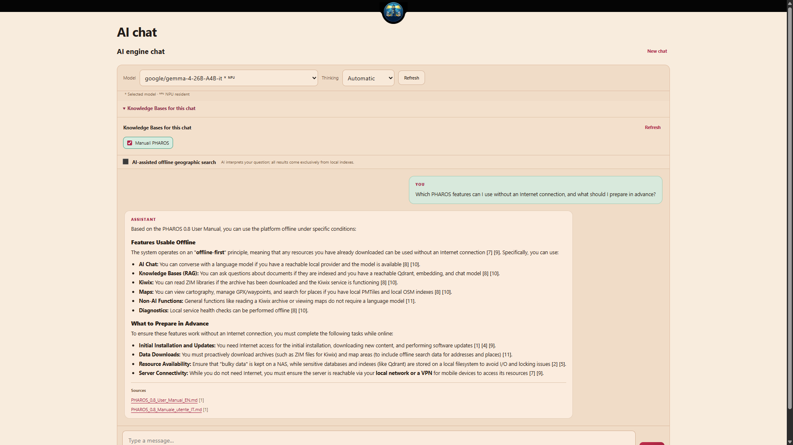
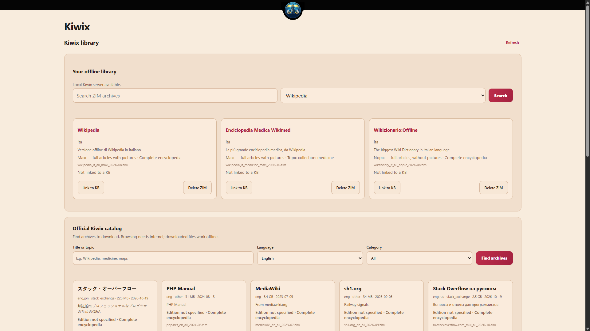
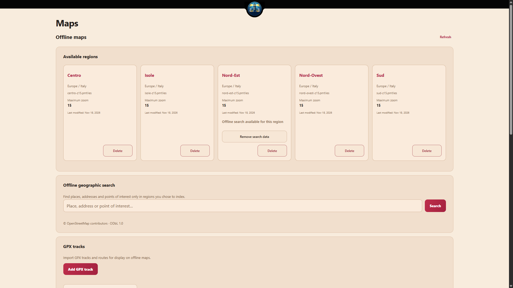
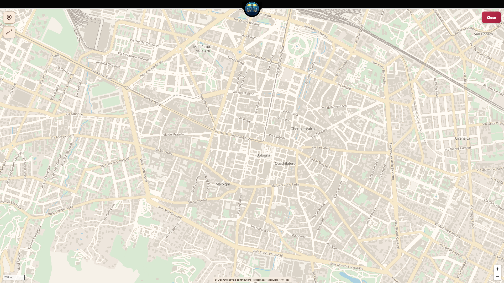
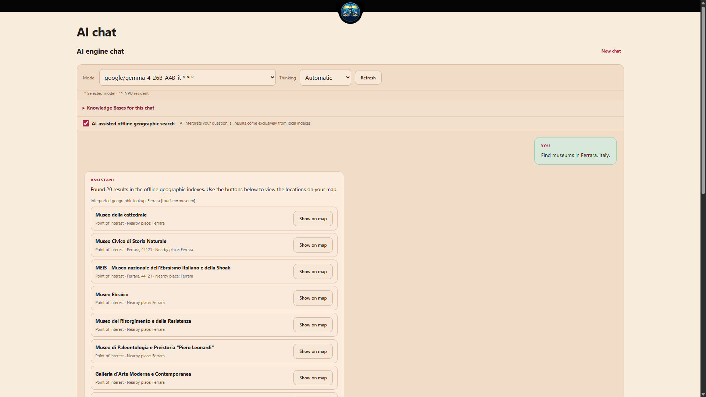
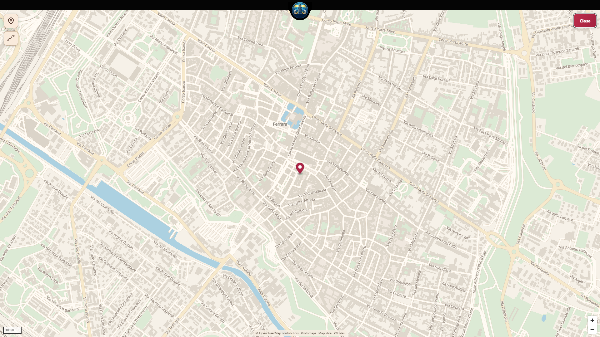
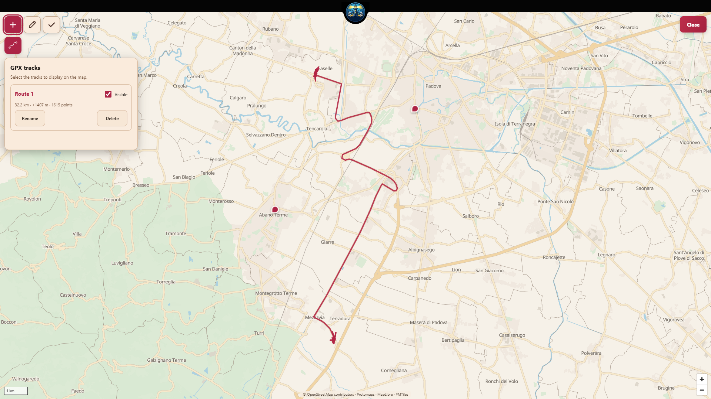

# PHAROS 0.8.0 — Screenshots / Screenshot

Actual screenshots of the PHAROS 0.8 release series, in English. Home shows the final version. / Schermate reali della serie 0.8 in inglese; la Home mostra la versione definitiva.

Map data © [OpenStreetMap contributors](https://www.openstreetmap.org/copyright), ODbL 1.0. Cartography: [Protomaps](https://protomaps.com/). See [third-party notices](../../THIRD_PARTY_NOTICES.md).

## Home dashboard / Dashboard

## AI chat / Chat IA

## Knowledge Bases / Knowledge Base

## RAG answer with citations / Risposta RAG con citazioni

## Kiwix offline library / Biblioteca Kiwix

## Offline map library / Biblioteca mappe

## Offline map viewer / Visualizzatore mappe offline

## AI geographic search / Ricerca geografica tramite IA

## Geographic search result / Risultato ricerca geografica

## GPX tracks and waypoints / Tracce GPX e waypoint

[English README](../../README.md) · [README italiano](../../README.it.md)
